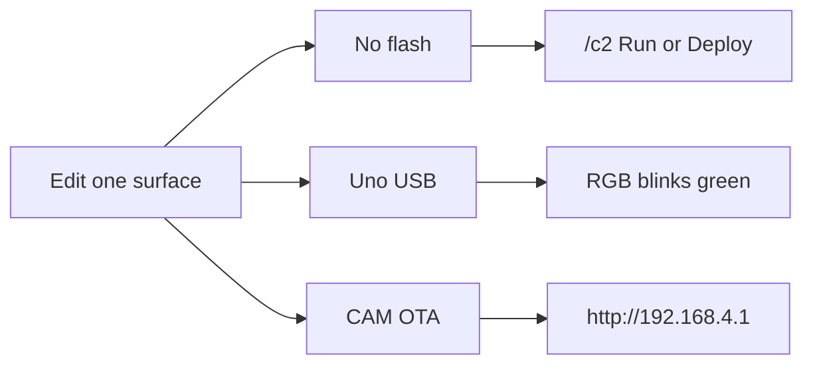

# GalaxyRVR hackathon

Get a rover driving, change one thing, and put that change back on the robot. Assembly photos and the printed screw list live in the [SunFounder GalaxyRVR docs](https://docs.sunfounder.com/projects/galaxy-rvr/en/latest/) ([assembly videos](https://docs.sunfounder.com/projects/galaxy-rvr/en/latest/assemble_video.html)). Flash detail: [deploy.md](../deploy.md). Drive, C2, and `rover.*`: [HOWTO.md](HOWTO.md). Bytes on the wire: [protocol.md](protocol.md).

```
Phone or laptop
        │  Wi-Fi  (GalaxyRVR-XXXXXX / 12345678)
        ▼
ESP32-CAM     camera, Wi-Fi, C2 Blockly, UDP/WebSocket bridge
        │  UART 115200
        ▼
Arduino UNO   motors, RGB, IR, ultrasonic, servo, battery
```

Remotes talk to the CAM. The CAM forwards motor and light bytes to the UNO. The UNO never joins Wi-Fi.

On-air name is `GalaxyRVR-` plus the last 6 hex digits of the CAM MAC (a sticker-style name such as `GalaxyRVR-A1B2C3`). Password `12345678`. The CAM is `192.168.4.1`. RGB **blinks green** while idle and turns **magenta** when a phone or the C2 page is connected.

## Bill of materials

Electronics from the [SunFounder hardware chapter](https://docs.sunfounder.com/projects/galaxy-rvr/en/latest/hardware/hardware.html). Screws, standoffs, and the rocker-bogie plates are in the printed **Component List and Assembly Instructions** that ships in the kit. Pins are [`galaxy-rvr/pins.h`](../galaxy-rvr/pins.h).

| Qty | Part | Role |
|---|---|---|
| 1 | SunFounder R3 board (Uno-compatible ATmega328P) | Body controller. Firmware: [`galaxy-rvr/`](../galaxy-rvr/) |
| 1 | GalaxyRVR shield | Motor ports, SONAR, camera, left/right IR, RGB, battery |
| 1 | ESP32-CAM + camera adapter | Wi-Fi, camera, C2, UDP/WebSocket. Firmware: [`ai-camera-firmware/`](../ai-camera-firmware/). No USB port; updates go over Wi-Fi |
| 1 | Ultrasonic module | Distance. Trig and echo share pin 10 |
| 2 | IR obstacle modules | Bumpers. Right pin 7, left pin 8. **LOW** means blocked |
| 4 | Analog RGB strips | Body lights. Blue 11, red 12, green 13 |
| 1 | Camera-tilt servo | Pin 6. Angle 0–140°, center 90 |
| 6 | TT gear motors + 6 wheels | Left pins 2/3, right pins 4/5 |
| 1 | Solar panel | Charge input on the shield |
| 1 | 18650 battery pack | Runs the rover. Sense on A3, about 6.6–8.4 V |
| 1 | USB cable | Laptop to the R3 board, for UNO upload only |

## Tools

**On the bench:** the kit Phillips screwdriver (also the tool for a CAM factory reset), the USB cable, and a clear floor.

**On the laptop**, from the repo root:

| You are changing | Install |
|---|---|
| Either firmware | Python 3. Deploy with `python3 tools/deploy.py` |
| UNO sketch | Arduino IDE 2.x or `arduino-cli`. Board package **Arduino AVR Boards 1.8.3**. Libraries `SoftPWM`, `Servo`, `ArduinoJson`, `SunFounder_AI_Camera` |
| ESP32-CAM or the C2 page | PlatformIO (`pio`). The OTA image must stay under **1280 KB** |
| iOS app | Xcode, and a physical iPhone on iOS 17 or later. The simulator cannot join the rover AP |
| Code with no robot | Dev Container, or `cmake` / `ctest`, plus `python3 ai-camera-firmware/tools/c2_local.py` |

The robot’s top switch is **Upload** while the USB cable is connected, and **Run** to drive. USB flashing from Docker on macOS is unreliable. Compile in the container if you want; flash the UNO from the host.

## Before you edit

A rover that already blinks green can skip to a track below. Otherwise flash both boards. Full steps: [deploy.md](../deploy.md).

```bash
python3 tools/deploy.py uno          # USB. Switch on Upload, then back to Run
python3 tools/deploy.py cam          # writes firmware.bin at the repo root
```

OTA the CAM from the rover, switch on **Run**:

1. Join `GalaxyRVR-XXXXXX` / `12345678` (use the name your phone actually shows).
2. Open [http://192.168.4.1](http://192.168.4.1).
3. **Update** and choose repo-root `firmware.bin` only.



## 1. Blockly, no compile

Join the rover Wi-Fi and open [http://192.168.4.1/c2](http://192.168.4.1/c2), or tap **CODE** in the iOS app.

**First program:** when robot turns on → forever → if distance `<` 20 then turn left 90 else move forward 1 ft.

- **Run** tries it while the page is open. Heartbeat is about 400 ms; closing the tab stops a live Run.
- **Deploy** stores the program on the rover. It keeps running after you close the page.
- **Stop** cuts the motors.
- **Remove from rover** forgets the stored program.

Stacks hang off the **when robot turns on** hat. Run and Deploy execute those entry stacks.

Try the same editor with no robot:

```bash
cd ai-camera-firmware
python3 tools/c2_local.py
# open http://127.0.0.1:8765/c2
```

The sidebar **Preview** map moves with the motors. On a real camera that panel stays hidden.

Editing the page itself ([`ai-camera-firmware/www-c2/`](../ai-camera-firmware/www-c2/)) is a CAM rebuild. Use track 3.

## 2. UNO behavior

Body code is [`galaxy-rvr/galaxy-rvr.ino`](../galaxy-rvr/galaxy-rvr.ino). The beginner calls are in [`galaxy-rvr/rover.h`](../galaxy-rvr/rover.h): `rover.drive`, `rover.lights`, `rover.sensors`, `rover.look`.

Power is about **0–100**. Distance is cached: call `ultrasonicUpdate()` once per loop. A failed ping returns `-1`, and `wallAhead()` treats that as an obstacle.

To keep the phone working, leave this loop in place and add behavior only while `currentMode == MODE_APP_CONTROL`. Otherwise the app and your sketch both write the motors.

```cpp
void loop() {
  appStateUpdate(aiCam.ws_connected);
  if (currentState == STATE_APP) {
    ultrasonicUpdate();
    handleSensorData();
    modeHandler();
  }
  aiCam.loop();
}
```

A sketch that replaces `loop()` still needs `rover.begin()`, a global `Servo servo`, and a global `AiCamera aiCam`. The phone will not drive until the app loop is back.

Deploy:

1. Switch the robot to **Upload** and plug in USB.
2. From the repo root: `python3 tools/deploy.py uno` (or `python3 tools/deploy.py uno -p /dev/cu.usbmodem1101`).
3. Switch back to **Run**.

Pass: RGB blinks green within a few seconds. Connecting a phone or opening `/c2` turns it magenta.

Host check with no board:

```bash
cmake --preset default && cmake --build --preset default
ctest --preset default --output-on-failure
```

## 3. Camera, C2 page, or iOS app

**CAM firmware or the Blockly page.** Edit [`ai-camera-firmware/`](../ai-camera-firmware/) or [`ai-camera-firmware/www-c2/`](../ai-camera-firmware/www-c2/), then:

```bash
python3 tools/deploy.py cam
```

That packs the Blockly UI, builds with PlatformIO, and copies `firmware.bin` to the repo root. Switch to **Run**, join the rover Wi-Fi, open [http://192.168.4.1](http://192.168.4.1), and **Update** with that `firmware.bin`. Wait until the page reports success, then restart if it asks.

Upload `firmware.bin` only. `firmware.elf` is the debug image and the CAM answers **Not Enough Space**.

**iOS app.** Open [`ios/GalaxyRVR/GalaxyRVR.xcodeproj`](../ios/GalaxyRVR/GalaxyRVR.xcodeproj), set your signing team, run on a phone, and allow **Local Network**. UI lives in `DriveView` / `DriveSession`. Bytes live in `BinaryProtocol`; `RoverUDPClient` sends them. **Join rover Wi-Fi** matches the SSID prefix `GalaxyRVR`.

Change a byte in both places: [`galaxy-rvr/protocol.cpp`](../galaxy-rvr/protocol.cpp) and [`ios/GalaxyRVR/GalaxyRVR/Protocol/BinaryProtocol.swift`](../ios/GalaxyRVR/GalaxyRVR/Protocol/BinaryProtocol.swift). The map is [protocol.md](protocol.md). Then flash the UNO (track 2) and rebuild the app.

```bash
swift test --package-path ios
python3 -m unittest discover -s test/c2 -v
```

## Demo

1. RGB blinks green a few seconds after **Run**.
2. The phone or laptop sees `GalaxyRVR-XXXXXX`.
3. [http://192.168.4.1](http://192.168.4.1) loads the settings page.
4. [http://192.168.4.1/c2](http://192.168.4.1/c2) loads Blockly.
5. **when robot turns on** → **move forward 1 sec** → **Run**. The rover rolls, then stops. RGB is magenta.
6. **Stop** cuts the motors.

## If it fails

| What you see | What to do |
|---|---|
| No `GalaxyRVR-…` network | Factory-reset the CAM. Power it, short **IO13–IO15** with the screwdriver, press reset, wait for two bright-LED blinks, release the short, press reset again. Name and password return to `GalaxyRVR-XXXXXX` / `12345678` |
| Update says **Not Enough Space** | You uploaded the ELF or another oversized file. Use repo-root `firmware.bin` (under 1280 KB) |
| AP is up, RGB never goes magenta, C2 and the phone cannot drive | UART link or UNO firmware. Reflash the UNO with the switch on **Upload**, then **Run** |
| Phone join button does nothing | It looks for an SSID starting with `GalaxyRVR`. Join that network yourself if you baked a different name |

Custom name, baked into both boards:

```bash
python3 tools/deploy.py --ssid MyRover --password hunter2x
```

SSID is at most 25 bytes (the CAM appends `-` and 6 hex digits). Password is 8–63 characters. Omit both flags to keep `GalaxyRVR` / `12345678`.
